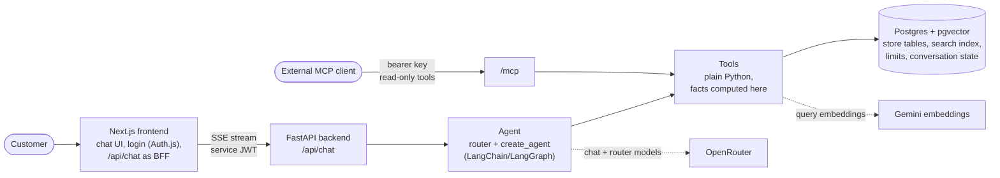
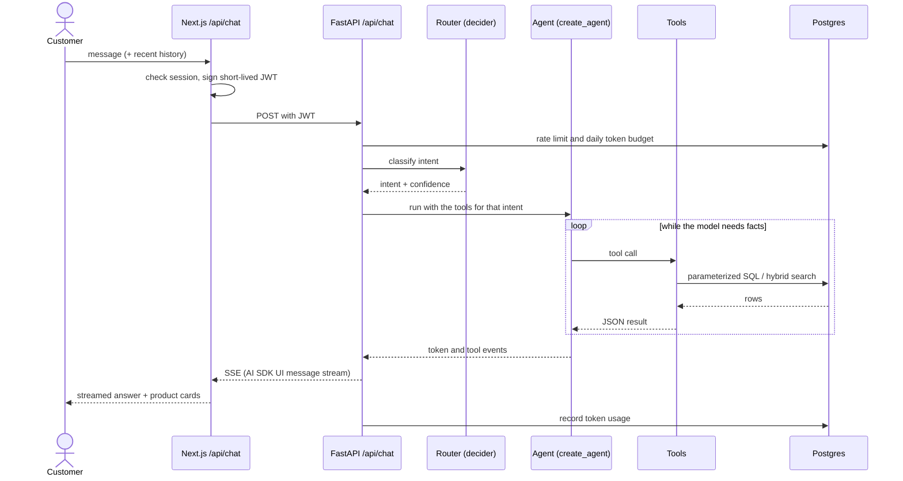
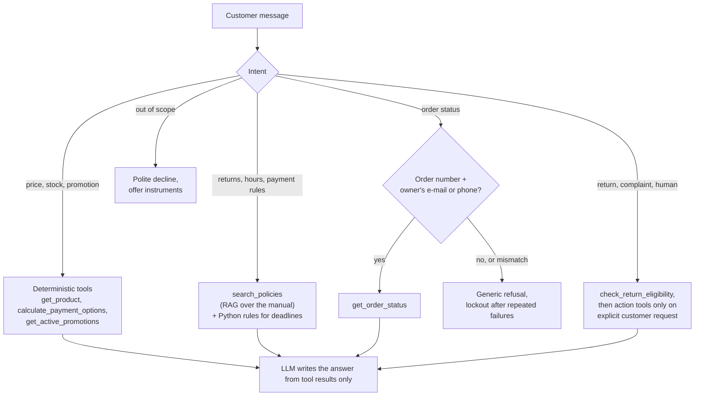
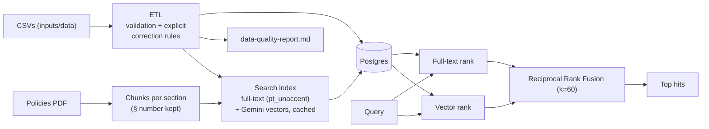
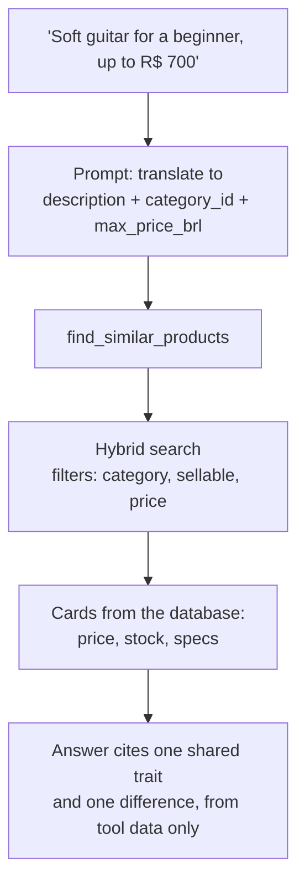
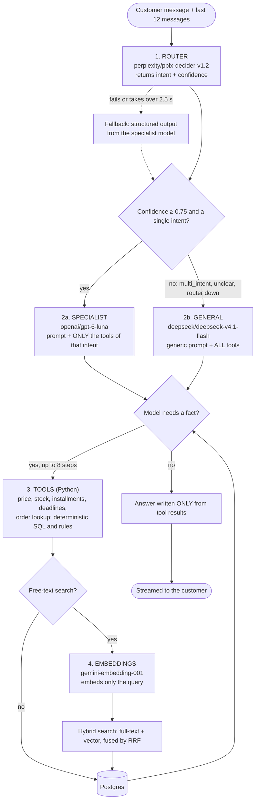
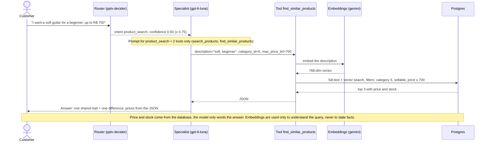

# Architecture diagrams

Mermaid diagrams (rendered by GitHub). Português: `README.pt-BR.md` embeds the same diagrams.

## 1. Containers

## 2. One chat turn

## 3. Fact or policy? Who answers

## 4. Data and retrieval

## 5. Semantic recommendation

## 6. AI core: which model runs when

Router decides the path; the specialist gets only the tools of its intent, the general model gets all of them. Embeddings only run inside a free-text search.

## 7. Worked example

A subjective request, from message to answer:

